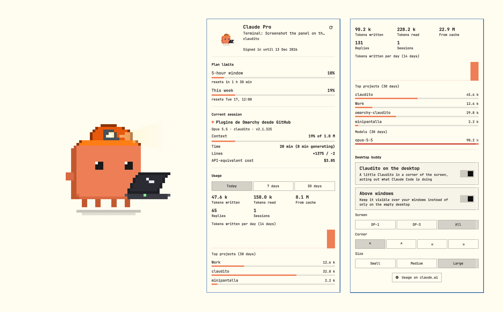

# Claudito para Omarchy

Un muñequito en pixel art para [Omarchy](https://omarchy.org/) que muestra lo
que está haciendo [Claude Code](https://claude.com/claude-code), con un
sombrero o casco distinto para cada tipo de trabajo, y un widget en la barra con
los límites y el uso de tu plan de Claude.

*[Read in English](README.md)*



Es la versión solo para Omarchy de
[Claudito](https://github.com/coricogit/claudito), que también tiene widgets
para KDE Plasma 6.

| Claude Code está… | Sombrero | Animación |
|---|---|---|
| Pensando en tu mensaje | Gorro con hélice | Gira la hélice, mira arriba, "…" |
| Editando o escribiendo archivos | Casco de obra | Martillea |
| Ejecutando comandos | Casco de minero | Teclea rápido, con la linterna |
| Leyendo o buscando código | Gorra de detective | Pasa la lupa |
| Buscando en la web | Salacot de explorador | Camina |
| Dirigiendo subagentes | Gorra de capitán | Señala adelante |
| Planificando tareas | Sombrero de mago | Destellos |
| Creando artifacts, skills, llamadas MCP | Boina | Pinta |
| Esperando tu permiso o respuesta | (se queda el sombrero) | Saluda, globo "!" |
| Falló una herramienta | — | Gota de sudor |
| Terminó | Gorro de fiesta | Salta con estrellas |
| Nada en 10 minutos | Gorro de dormir | Zzz |

## Qué incluye

- **En la barra**: un mini Claudito y cuánto llevas de la ventana de 5 horas.
  Da saltitos mientras Claude Code trabaja, suda a partir del 80 % de un límite
  del plan y le sale un **!** naranja cuando Claude Code te está esperando. Al
  pasar el ratón ves los dos límites y cuándo se reinician. Al hacer clic
  muestra:
  - tu plan y tu cuenta (el email queda oculto hasta que haces clic)
  - los límites del plan: ventana de 5 horas y semanal, con cuándo se reinicia cada una
  - la sesión actual de Claude Code: nombre, modelo, proyecto, contexto usado,
    tiempo, líneas cambiadas y coste equivalente en API
  - tokens escritos y leídos, respuestas y sesiones de hoy, 7 y 30 días, una
    gráfica de 14 días y los proyectos y modelos que más usas
  - los ajustes del muñequito del escritorio, de su ropa de estación y de los
    avisos
- **En el escritorio**: Claudito en una esquina de la pantalla, debajo de tus
  ventanas como un widget de escritorio, con un rótulo de lo que está haciendo
  y en qué proyecto. Desde el panel de la barra puedes ocultarlo, ponerlo
  encima de las ventanas y elegir su pantalla (o todas), esquina y tamaño. Haz clic en él para darle
  un toque. Se oculta mientras una ventana a pantalla completa cubre su
  pantalla.
- **Estaciones**: Claudito se viste según la estación de donde vives (por el
  país de tu zona horaria, así que acierta en los dos hemisferios). El gorro
  sale cuando no lleva uno de trabajo; el traje, siempre. En el panel puedes
  elegir otra estación o quitarle cualquiera de las dos prendas.

  | Estación | Gorro | Traje |
  |---|---|---|
  | Primavera | Corona de flores | Peto de jardinero |
  | Verano | Sombrero de paja | Camisa hawaiana |
  | Otoño | Gorro de bellota con una hoja | Suéter tejido |
  | Invierno | Gorro de lana con pompón | Bufanda |

- **Avisos**, durante 5 segundos, cuando Claude lleva más de 5 segundos
  esperándote y cuando termina una tarea de un minuto o más. De los permisos en
  la aplicación de escritorio de Claude avisa ella misma.
- **Varias sesiones**: primero se muestra la que te necesita, después las que
  trabajan y al final las inactivas.

El panel sigue el tema y el idioma de Omarchy (inglés y español) y se maneja con
el teclado (`j`/`k`, `h`/`l`, Enter).

## Instalación

Necesitas Omarchy, Python 3 y `jq` (los dos vienen con Omarchy).

```bash
omarchy plugin add https://github.com/coricogit/omarchy-claudito.git --enable
```

Eso añade el plugin y lo pone en la barra. Después abre su panel y pulsa
**Conectar con Claude Code**. Nada toca tus ajustes de Claude Code hasta que lo
pulses.

Al conectar se añade `claudito-hook` como hook asíncrono y
`claudito-statusline` como status line en `~/.claude/settings.json`. Respeta el
resto de tus ajustes y hooks, no toca una status line que ya tengas y guarda
una copia privada en `settings.json.claudito-backup`. Desde la terminal, el
mismo paso es `~/.config/omarchy/plugins/corico.claudito/setup`.

Las sesiones nuevas de Claude Code usan los hooks automáticamente. En una sesión
que ya estaba abierta, ejecuta `/hooks` una vez.

Para actualizar: `omarchy plugin update corico.claudito`.

Para mostrar u ocultar el muñequito con un atajo:
`omarchy-shell corico.claudito toggle`. Para pasarlo a otra pantalla:
`omarchy-shell corico.claudito monitor DP-2` (los nombres salen de `hyprctl monitors`),
o `omarchy-shell corico.claudito monitor all` para tenerlo en todas.

## Desinstalación

```bash
~/.config/omarchy/plugins/corico.claudito/setup --remove
omarchy plugin remove corico.claudito
```

La primera línea quita el hook y la status line de `~/.claude/settings.json`.
Si te la saltas no se rompe nada: cada comando comprueba que su script sigue
ahí y no hace nada cuando el plugin ya no está, así que puedes limpiar
`settings.json` más tarde.

## Cómo funciona

`claudito-hook` se ejecuta en los eventos de sesión, mensaje, herramientas,
notificaciones y fin. Guarda la actividad de cada sesión en
`$XDG_RUNTIME_DIR/claudito/state.json` (una carpeta en RAM que solo puede leer tu
usuario) y `claudito-watch`, que funciona mientras lo hace el plugin, decide a
partir de él qué mostrar. Ningún hook avisa cuando respondes a un permiso,
pulsas Esc o cierras la terminal, así que también mira el estado que Claude
Code guarda en `~/.claude/sessions`. Esa carpeta es interna de Claude Code: si
cambia, Claudito vuelve a usar solo los hooks. El rótulo muestra nombres de archivo, patrones de búsqueda,
dominios web y la descripción de los comandos de terminal, nunca el contenido
de los archivos.

Los límites del plan y la sesión en vivo salen de la status line de Claude
Code, que `claudito-statusline` guarda al lado, así que se actualizan mientras
Claude Code está abierto. El historial sale de tus transcripciones locales en
`~/.claude/projects` (las lee `claudito-usage` y las guarda en caché en
`~/.cache/claudito`) y la cuenta, de `claude auth status`. No se envía nada a
ningún sitio.

Si el hook falla, lo deja escrito en `hook.log`, junto a `state.json`.
Pruebas: `python3 tests/test_claudito.py`.

Tus ajustes se guardan en `~/.local/state/claudito/omarchy.json`.

## Licencia

[MIT](LICENSE).
