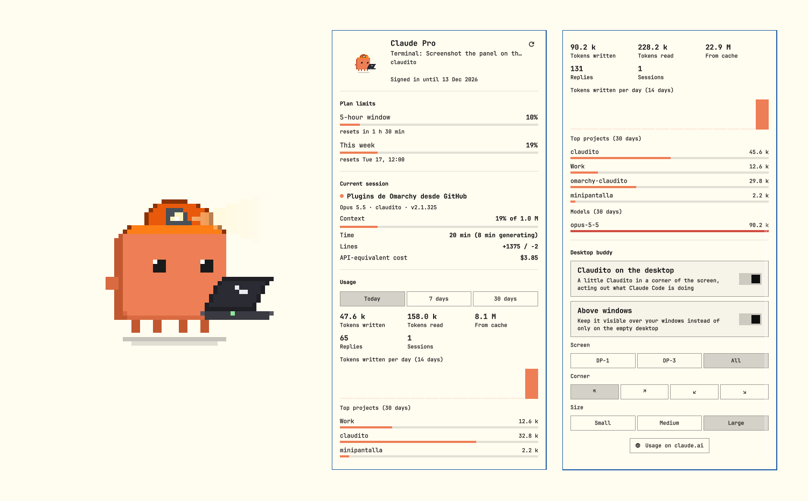

# Claudito for Omarchy

A pixel-art buddy for [Omarchy](https://omarchy.org/) that shows what
[Claude Code](https://claude.com/claude-code) is doing, with a different hat
or helmet for each kind of work, plus a bar widget with your Claude plan
limits and usage.

*[Leer en español](README.es.md)*



This is the Omarchy-only version of
[Claudito](https://github.com/coricogit/claudito), which also has KDE Plasma 6
widgets.

| Claude Code is… | Hat | Animation |
|---|---|---|
| Thinking about your message | Propeller beanie | Propeller spins, looks up, "…" |
| Editing or writing files | Construction hard hat | Hammers away |
| Running terminal commands | Miner's helmet | Types fast, lamp beam |
| Reading or searching code | Detective deerstalker | Magnifier sweep |
| Searching the web | Pith helmet | Walks in place |
| Running subagents | Captain's cap | Points ahead |
| Planning / tracking tasks | Wizard hat | Sparkles |
| Making artifacts, skills, MCP calls | Beret | Paints |
| Waiting for your permission or answer | (keeps its hat) | Waves, "!" bubble |
| A tool failed | — | Sweat drop |
| Finished | Party hat | Jumps with stars |
| Nothing going on for 10 min | Nightcap | Zzz |

## What you get

- **In the bar**: a tiny Claudito and how much of the 5-hour window you've
  used. It hops while Claude Code works and sweats near the limit. Click it for:
  - your plan and account (email hidden until you click it)
  - plan limits: 5-hour window and week, with when each one resets
  - the current Claude Code session: name, model, project, context used, time,
    lines changed and API-equivalent cost
  - tokens written/read, replies and sessions for today, 7 and 30 days, a
    14-day chart and the projects and models you use most
  - the desktop buddy's settings
- **On the desktop**: Claudito in a corner of the screen, under your windows
  like a desktop widget, with a caption saying what it's doing and in which
  project. From the bar panel you can hide it, keep it above your windows, and
  pick its screen (or all of them), corner and size. Click it to poke it.

The panel follows the Omarchy theme and language (English and Spanish) and
works with the keyboard (`j`/`k`, `h`/`l`, Enter).

## Install

Needs Omarchy, Python 3 and `jq` (both come with Omarchy).

```bash
omarchy plugin add https://github.com/coricogit/omarchy-claudito.git --enable
```

That adds the plugin and puts it in the bar. Then open its panel and press
**Connect to Claude Code**. Nothing touches your Claude Code settings until you
press it.

Connecting adds `claudito-hook` as an async hook and `claudito-statusline` as
your status line in `~/.claude/settings.json`. Your other settings and hooks
are kept, a status line you already have is left alone, and a private backup
goes to `settings.json.claudito-backup`. From a terminal, the same step is
`~/.config/omarchy/plugins/corico.claudito/setup`.

New Claude Code sessions pick the hooks up on their own. In a session that is
already open, run `/hooks` once.

Update with `omarchy plugin update corico.claudito`.

To show or hide the buddy from a keybinding:
`omarchy-shell corico.claudito toggle`. To move it to another screen:
`omarchy-shell corico.claudito monitor DP-2` (names from `hyprctl monitors`),
or `omarchy-shell corico.claudito monitor all` for every screen.

## Remove

```bash
~/.config/omarchy/plugins/corico.claudito/setup --remove
omarchy plugin remove corico.claudito
```

The first line takes the hook and status line out of
`~/.claude/settings.json`. If you skip it, nothing breaks: each command checks
that its script is still there and does nothing once the plugin is gone, so you
can tidy `settings.json` later.

## How it works

`claudito-hook` runs on session, prompt, tool, notification and stop events.
It writes the current activity of each session to
`$XDG_RUNTIME_DIR/claudito/state.json` (a RAM folder only your user can read),
and the plugin reads that file. With several sessions open, it follows the
most recent one. The caption shows file names, search patterns, web domains and
the descriptions of terminal commands, never file contents.

Plan limits and the live session come from Claude Code's status line, which
`claudito-statusline` saves next to it, so they update while Claude Code is
open. The history comes from your local transcripts in `~/.claude/projects`
(read by `claudito-usage`, cached in `~/.cache/claudito`), and the account from
`claude auth status`. Nothing is sent anywhere.

The buddy's settings live in `~/.local/state/claudito/omarchy.json`.

## License

[MIT](LICENSE).
